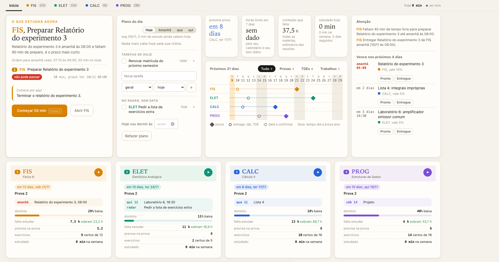
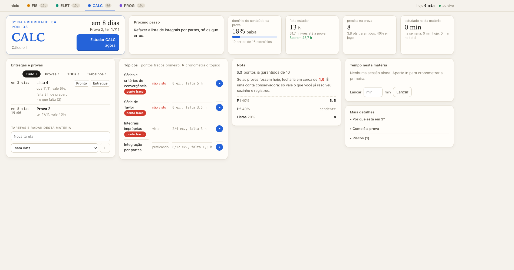

# Painel de Estudos

Painel web local, ao vivo, que responde uma pergunta: **o que eu estudo agora?**



## Por que existe

Fim de semestre, várias disciplinas, estágio e as segundas provas caindo na mesma quinzena. Eu tinha
calendário, lembretes e anotações, mas nenhuma tela que juntasse tudo e dissesse o que valia mais a
pena fazer naquela hora. Montei este painel para resolver isso para mim, e passei a usar no mesmo dia.

Este repositório é a **versão genérica**: as disciplinas, notas e a rotina que vêm aqui são de exemplo.

## O que ele faz

- **Recomenda o que estudar agora**, com o motivo em uma frase e os números por trás
- **Ranking das disciplinas** por urgência, peso na média, o que falta saber, carga de horas e risco de reprovar
- **Domínio por tópico** calculado a partir de exercícios feitos e certos, não de sensação
- **Nota projetada e nota necessária** na próxima prova, a partir da composição da média
- **Plano do dia** em blocos de 50 min, encaixados nas horas livres da rotina semanal e do Calendário (macOS)
- **Entregas com preparo**: reserva tempo de trás para frente a partir do prazo e avisa quando não cabe
- **Timer de estudo** por disciplina e por tópico; o tempo real corrige as estimativas de horas
- **Tarefas livres** por dia ou sem data, e entregas marcadas como "pronto" ou "entregue"
- Atualização ao vivo por SSE, sem recarregar



## Como rodar

Precisa só de Node 18 ou mais novo. Não tem dependência nem build.

```bash
node exemplo/gerar.js   # grava dados fictícios em data/
node server.js          # abre em http://localhost:4747
```

Para usar com as suas disciplinas, edite `data/disciplinas.json`:

```json
[{ "sigla": "CALC", "cor": "#2563d9" }, { "sigla": "FIS", "cor": "#d98200" }]
```

e envie o dado de cada uma com `POST /api/materia/<SIGLA>`. O formato completo está em
[docs/CONTRATO.md](docs/CONTRATO.md). A rotina semanal fica em `data/rotina.json` (o servidor usa uma
rotina de exemplo enquanto o arquivo não existir).

## Como é por dentro

```
quem alimenta                      servidor (server.js)                     tela
┌──────────────────────┐   POST    ┌───────────────────────────┐   SSE    ┌──────────────────┐
│ um agente por        │ ───────▶  │ normaliza o dado           │ ──────▶ │ public/index.html │
│ disciplina, ou você  │           │ motor de prioridade        │         │ um arquivo, sem   │
│ com curl             │           │ agendador (rotina +        │ ◀────── │ framework         │
└──────────────────────┘           │   calendário + prazos)     │  timer, └──────────────────┘
┌──────────────────────┐           │ timer e histórico          │  tarefas
│ Calendário (EventKit)│ ───────▶  │ JSON em data/, escrita     │
│ leitor Swift, só lê  │           │   atômica                  │
└──────────────────────┘           └───────────────────────────┘
```

| Peça | Escolha |
|---|---|
| Backend | Node puro, um arquivo, HTTP + Server-Sent Events |
| Persistência | arquivos JSON com escrita atômica (temporário + rename) |
| Frontend | um HTML com CSS e JS inline |
| Calendário | binário Swift pequeno usando EventKit, somente leitura (opcional, só macOS) |
| Testes | `./test.sh`, 226 verificações de integração contra um servidor temporário |

No meu uso, cada disciplina tem uma sessão do Claude Code que estuda comigo, mantém o JSON daquela
disciplina e avisa o painel a cada mudança (exercício resolvido, tópico dominado, tempo gasto). O painel
não depende disso: qualquer coisa que faça `POST` no formato do contrato serve.

### Calendário (opcional, macOS)

```bash
cd calendario
swiftc ler-calendario.swift -o ler-calendario \
  -Xlinker -sectcreate -Xlinker __TEXT -Xlinker __info_plist -Xlinker Info.plist
```

Na primeira execução o macOS pede permissão de acesso ao Calendário. Sem o binário, o painel funciona
com a rotina semanal e um teto de horas por dia.

### Sempre no ar (opcional, macOS)

Há um LaunchAgent de exemplo em [docs/local.painel-estudos.plist](docs/local.painel-estudos.plist).

### Testes

```bash
./test.sh
```

Usa diretório de dados e porta temporários. Depende de `curl` e do `date` do macOS (BSD).

## Limites, sem enfeite

- **Segurança não foi considerada.** É uma ferramenta de uso próprio, pensada para rodar em
  `127.0.0.1`: não tem autenticação, o CORS é liberado e qualquer processo local pode ler e escrever.
  Não exponha na rede nem na internet do jeito que está.
- Um usuário só, fuso `America/Sao_Paulo` fixo, textos em português.
- O motor de prioridade usa pesos escolhidos à mão. Ainda não há histórico suficiente para dizer o
  quanto as recomendações acertam.
- Foi construído em poucos dias com ajuda pesada de IA (Claude Code): eu defini o problema, as regras
  e revisei cada iteração; boa parte do código foi escrita por agentes.

## Licença

MIT. Veja [LICENSE](LICENSE).
